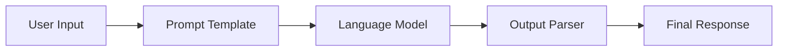
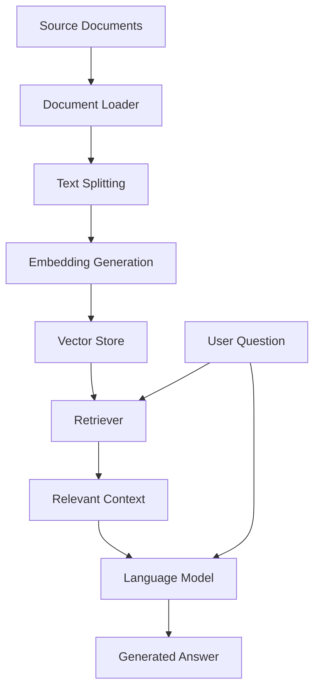
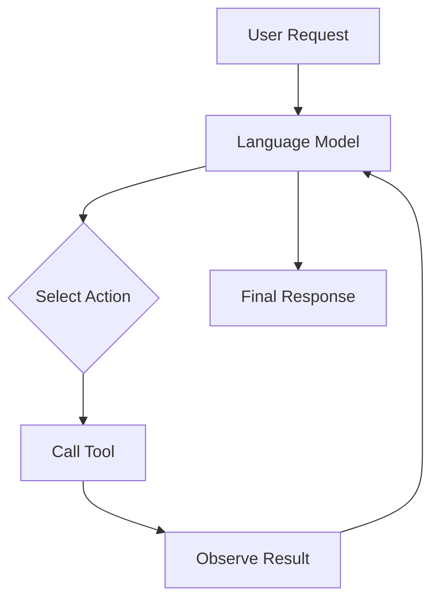

<div align="center">

# 🦜 LangChain AI Application Prototypes

### Exploring LLMs, RAG, AI Agents & Generative AI

**A hands-on collection of Python experiments for building intelligent applications with LangChain, Large Language Models, embeddings, vector databases, and modern AI workflows.**

<br>

[](https://www.python.org/)
[](https://www.langchain.com/)
[](https://openai.com/)
[](https://streamlit.io/)
[](https://github.com/ramtanay/LangChain-AI-Application-Prototypes)

<br>

[🚀 Explore Repository](https://github.com/ramtanay/LangChain-AI-Application-Prototypes)
&nbsp; • &nbsp;
[🐛 Report a Bug](https://github.com/ramtanay/LangChain-AI-Application-Prototypes/issues)
&nbsp; • &nbsp;
[👨‍💻 Connect with Me](https://github.com/ramtanay)

</div>

---

## 📌 Table of Contents

- [🚀 About the Project](#-about-the-project)
- [🎯 Project Goals](#-project-goals)
- [✨ Key Features](#-key-features)
- [🧠 Concepts Explored](#-concepts-explored)
- [🏗️ Repository Structure](#️-repository-structure)
- [🛠️ Technology Stack](#️-technology-stack)
- [⚙️ Getting Started](#️-getting-started)
- [🔑 Environment Configuration](#-environment-configuration)
- [▶️ Running the Examples](#️-running-the-examples)
- [🗺️ Learning Roadmap](#️-learning-roadmap)
- [🔮 Future Improvements](#-future-improvements)
- [🤝 Contributing](#-contributing)
- [👨‍💻 Author](#-author)

---

## 🚀 About the Project

**LangChain AI Application Prototypes** is a collection of Python-based experiments exploring how to build applications powered by Large Language Models (LLMs) using the LangChain ecosystem.

The project covers the journey from foundational LLM integrations to more advanced application patterns, including composable chains, prompt engineering, Retrieval-Augmented Generation (RAG), conversational AI, embeddings, and tool-using agents.

It also includes experiments involving audio and image processing, providing a foundation for exploring AI applications beyond text.

Whether you're learning how LLM applications work or experimenting with different AI architectures, this repository serves as a practical space to build, test, and understand Generative AI concepts.

> 💡 **The goal:** Learn by building, experiment with different approaches, and understand how individual AI components work together to create useful applications.

## 🎯 Project Goals

- 🧠 Understand how LLM-powered applications work.
- 🔗 Build reusable workflows with LangChain Expression Language (LCEL).
- 📝 Explore prompt engineering and structured model outputs.
- 📚 Implement document-based question answering with RAG.
- 💬 Work with conversational context and chat history.
- 🔍 Experiment with text embeddings and vector databases.
- 🤖 Explore AI agents and tool integration.
- 🎙️ Experiment with audio-processing applications.
- 🖼️ Explore image-processing workflows.
- 🛠️ Improve practical Python and AI application development skills.

---

## ✨ Key Features

<table>
  <tr>
    <td width="50%" valign="top">

### 🧠 LLM Integrations

Explore language models and experiment with different ways of interacting with LLM providers.

**Explore:** Model invocation, configuration, and application workflows.

    </td>
    <td width="50%" valign="top">

### 🔗 Chains & LCEL

Build composable workflows by connecting prompts, language models, output parsers, and other runnable components.

**Explore:** Sequential execution and reusable chains.

    </td>
  </tr>
  <tr>
    <td width="50%" valign="top">

### 📚 Retrieval-Augmented Generation

Experiment with document loading, text splitting, embeddings, retrieval, and context-aware answer generation.

**Explore:** Document question answering and vector search.

    </td>
    <td width="50%" valign="top">

### 💬 Conversational AI

Explore conversation history and question answering that takes earlier messages into account.

**Explore:** Chat history, contextual questions, and interactive interfaces.

    </td>
  </tr>
  <tr>
    <td width="50%" valign="top">

### 🤖 AI Agents

Investigate how LLM applications can select and use tools to perform tasks.

**Explore:** Tool integration, search, and agent workflows.

    </td>
    <td width="50%" valign="top">

### 🎙️ Audio & Image Experiments

Explore AI-related applications involving audio transcription and image processing.

**Explore:** Input processing and multimodal application concepts.

    </td>
  </tr>
</table>

---

## 🧠 Concepts Explored

### 1. 🔗 LangChain Expression Language (LCEL)

LCEL provides a way to compose individual components into reusable workflows.

**Concepts covered:**
- Prompt templates
- Model invocation
- Output parsers
- Runnable composition
- Sequential processing
- Connecting multiple processing steps

**Typical workflow:**



### 2. 📚 Retrieval-Augmented Generation (RAG)

RAG combines information retrieval with language generation. Instead of relying only on information learned during model training, an application can retrieve relevant information from a document collection and use it to answer a question.

**Typical RAG workflow:**



**Concepts explored:**
- Document loaders
- Recursive text splitting
- Embedding generation
- Vector stores
- Similarity search
- Retriever-based question answering
- Context-grounded responses

### 3. 💬 History-Aware RAG

In a conversational application, a user's latest question may depend on something discussed earlier.

For example:

**User:** What is Retrieval-Augmented Generation?

**Assistant:** RAG combines information retrieval with language generation.

**User:** What are its advantages?

A history-aware retriever can use the conversation history to interpret the follow-up question before retrieving relevant information.

**Concepts explored:**
- Conversation history
- Message placeholders
- Contextual question reformulation
- History-aware retrieval
- Conversational question answering
- Streamlit chat interfaces

### 4. 🤖 AI Agents

AI agents can use language models to select tools and perform tasks through structured workflows.

**Typical agent workflow:**



**Concepts explored:**
- Tool integration
- External search
- Knowledge retrieval
- Agent execution
- Tool outputs and observations
- LLM-driven decision workflows

*The diagram illustrates a general agent pattern; the actual implementation depends on the example and framework version.*

### 5. 🎙️ Audio & Image Processing

The repository also includes experiments involving audio and image-processing applications.

These experiments explore how input data beyond plain text can be processed as part of AI-powered workflows.

**Areas of exploration:**
- Audio-processing experiments
- Speech-related applications
- Image-processing workflows
- Integrating input-processing components into applications

---

## 🏗️ Repository Structure

The repository is organized into modules covering different areas of LLM application development.

```text
LangChain-AI-Application-Prototypes/
│
├── basics/             # Foundational LLM integrations
├── chains/             # LCEL and chain composition
├── prompttemplates/    # Prompt templates and prompt engineering
├── chathistory/        # Conversation history experiments
├── embeddings/         # Embeddings and similarity search
│
├── rag/                # Retrieval-Augmented Generation
│   ├── rag_demo.py
│   ├── pdf_rag_demo.py
│   └── historyaware_rag_demo.py
│
├── agents/             # AI agents and tool integration
├── audio_whisper/      # Audio-processing experiments
├── imageprocessing/    # Image-processing experiments
├── assignments/        # Exercises and additional experiments
│
├── requirements.txt    # Python dependencies
└── README.md           # Project documentation
```

> **Note:** This tree highlights the intended organization and the example files referenced in this README. File names, directory contents, and dependencies may change as the project evolves. Check the repository for the latest structure before running a particular example.

---

## 🛠️ Technology Stack

| Technology | Purpose |
|---|---|
| **Python** | Core programming language |
| **LangChain** | Building LLM-powered applications |
| **LangChain Expression Language (LCEL)** | Composing reusable AI workflows |
| **OpenAI API** | Language models and embeddings for supported examples |
| **Ollama** | Local language-model experimentation |
| **Chroma** | Vector storage and retrieval in supported examples |
| **Streamlit** | Interactive application interfaces |
| **Document-processing libraries** | Loading and preparing documents |
| **Audio and image libraries** | Audio- and image-processing experiments |

The dependencies required depend on the example being executed. Not every technology listed above is necessarily used by every module.

---

## ⚙️ Getting Started

Follow these steps to set up the repository locally.

### Prerequisites

Before you begin, install:

- [Python](https://www.python.org/downloads/)
- [Git](https://git-scm.com/downloads/)
- An OpenAI API key for examples that use the OpenAI API
- [Ollama](https://ollama.com/) for examples that use local Ollama models
- An internet connection for examples that call external APIs or services

You do not need every service for every example. Install and configure only what your selected module requires.

### 1. Clone the Repository

```bash
git clone https://github.com/ramtanay/LangChain-AI-Application-Prototypes.git
```

Move into the project directory:

```bash
cd LangChain-AI-Application-Prototypes
```

### 2. Create a Virtual Environment

Create an isolated Python environment to avoid conflicts with other projects.

```bash
python -m venv .venv
```

**Windows — PowerShell:**

```powershell
.\.venv\Scripts\Activate.ps1
```

**Windows — Command Prompt:**

```bat
.venv\Scripts\activate.bat
```

**Linux / macOS:**

```bash
source .venv/bin/activate
```

### 3. Upgrade pip

```bash
python -m pip install --upgrade pip
```

### 4. Install Dependencies

```bash
pip install -r requirements.txt
```

**Important:** The dependency file may not include every package required by every experiment. If an example reports a missing module, check that example's imports and install the appropriate dependency inside your virtual environment.

For reproducible setups, consider maintaining a complete dependency list for each module or updating the project-wide requirements file.

---

## 🔑 Environment Configuration

Some examples require API keys or external services.

### Configure an OpenAI API Key

**Windows — PowerShell:**

```powershell
$env:OPENAI_API_KEY = "your_api_key_here"
```

**Windows — Command Prompt:**

```bat
set OPENAI_API_KEY=your_api_key_here
```

**Linux / macOS:**

```bash
export OPENAI_API_KEY="your_api_key_here"
```

Replace `your_api_key_here` with your own API key.

These commands configure the variable for the current terminal session. If you open another terminal, you may need to configure it again.

### Optional: Use a `.env` File

If the selected example supports loading environment variables from a `.env` file, you can create one in the appropriate directory:

```env
OPENAI_API_KEY=your_api_key_here
```

Make sure `.env` is included in `.gitignore` before adding secrets.

**🔐 Security checklist:**

- Never commit API keys, passwords, or access tokens.
- Never paste real secrets into source code.
- Keep `.env` files out of Git.
- Rotate a key immediately if it is accidentally exposed.
- Configure only the credentials required by the selected example.

---

## ▶️ Running the Examples

The following commands correspond to the example paths referenced in this README. Run them from the repository root, after checking the required dependencies, input files, and environment variables.

### 📚 Basic RAG

```bash
python rag/rag_demo.py
```

Explore document retrieval and question answering.

### 📄 PDF-Based RAG

```bash
python rag/pdf_rag_demo.py
```

Explore a RAG workflow that loads a PDF document.

Make sure the PDF expected by the script exists at the path the script uses.

### 💬 History-Aware RAG

```bash
streamlit run rag/historyaware_rag_demo.py
```

Explore conversational question answering with chat history.

### 🤖 AI Agent

```bash
streamlit run agents/agent_demo.py
```

This command is applicable if the repository contains `agents/agent_demo.py`. Check the `agents/` directory for the actual entry-point filename before running it.

> **Troubleshooting tip:** If a command fails, first verify the file path, Python environment, installed dependencies, API keys, and required input files. Different examples may require different configurations.

---

## 🗺️ Learning Roadmap

A suggested order for exploring the concepts in this repository:

| Stage | Topic | What to Learn |
|---|---|---|
| 01 | 🧠 LLM Basics | Model invocation and basic interactions |
| 02 | 📝 Prompt Engineering | Designing prompts and managing model inputs |
| 03 | 🔗 LCEL & Chains | Connecting components into reusable workflows |
| 04 | 🔍 Embeddings | Representing text and comparing semantic similarity |
| 05 | 📚 RAG | Retrieving document context for question answering |
| 06 | 💬 Conversational RAG | Using chat history to interpret follow-up questions |
| 07 | 🤖 AI Agents | Integrating tools into LLM-powered workflows |
| 08 | 🎙️ Audio & Images | Exploring input processing beyond plain text |

**Suggested approach:** Start with small examples, understand each component, and then combine the components into a larger application.

---

## 🔮 Future Improvements

Ideas for improving the project over time:

- [ ] Improve dependency management and setup instructions.
- [ ] Document prerequisites for individual examples.
- [ ] Add automated tests for reusable components.
- [ ] Improve input validation and error handling.
- [ ] Add persistent vector storage where appropriate.
- [ ] Evaluate retrieval quality with representative questions.
- [ ] Improve source attribution in RAG responses.
- [ ] Improve conversational session management.
- [ ] Add automated testing with GitHub Actions.
- [ ] Document deployment options for selected applications.
- [ ] Add example screenshots and usage demonstrations.

---

## 🎓 Learning Outcomes

This repository provides practical exposure to concepts relevant to Generative AI and AI application development.

By exploring the examples, you can develop familiarity with:

- Large Language Model integrations
- Prompt engineering
- LangChain and LCEL
- Composable AI workflows
- Embeddings and vector similarity search
- Retrieval-Augmented Generation
- Conversational context management
- Tool-using AI agents
- Interactive applications with Streamlit
- Experimenting with different AI application architectures

The actual learning outcomes depend on which examples you implement, test, and extend.

---

## 🤝 Contributing

Suggestions, bug reports, documentation improvements, and new experiments are welcome!

If you'd like to contribute:

1. Fork the repository.
2. Create a feature branch.
3. Make your changes.
4. Test the affected example.
5. Update the documentation if necessary.
6. Submit a pull request explaining your changes.

For significant changes, consider opening an issue first to discuss the proposed improvement.

If you find a bug, please include the relevant error message, the example you were running, and the steps needed to reproduce it. **Never include API keys or other secrets in an issue.**

---

## 👨‍💻 Author

<div align="center">

### Ramtanay Chakraborty

**Computer Science Engineer | Python Developer | Generative AI Enthusiast**

Exploring the intersection of Python, backend development, and Generative AI.

<br>

[](https://github.com/ramtanay)

<br>

⭐ **If you find this repository useful, consider giving it a star!**

</div>

---

<div align="center">

**Built with Python, curiosity, and a passion for Generative AI. 🦜**

</div>
