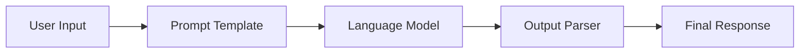
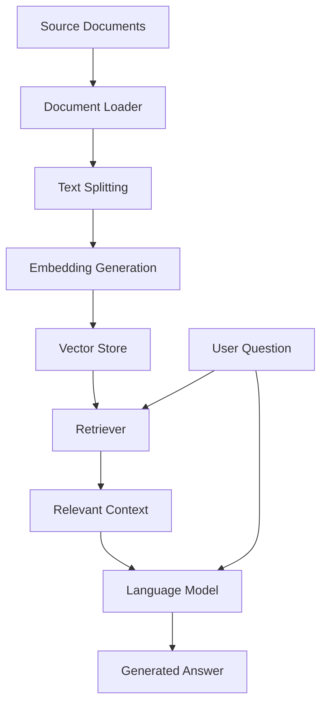
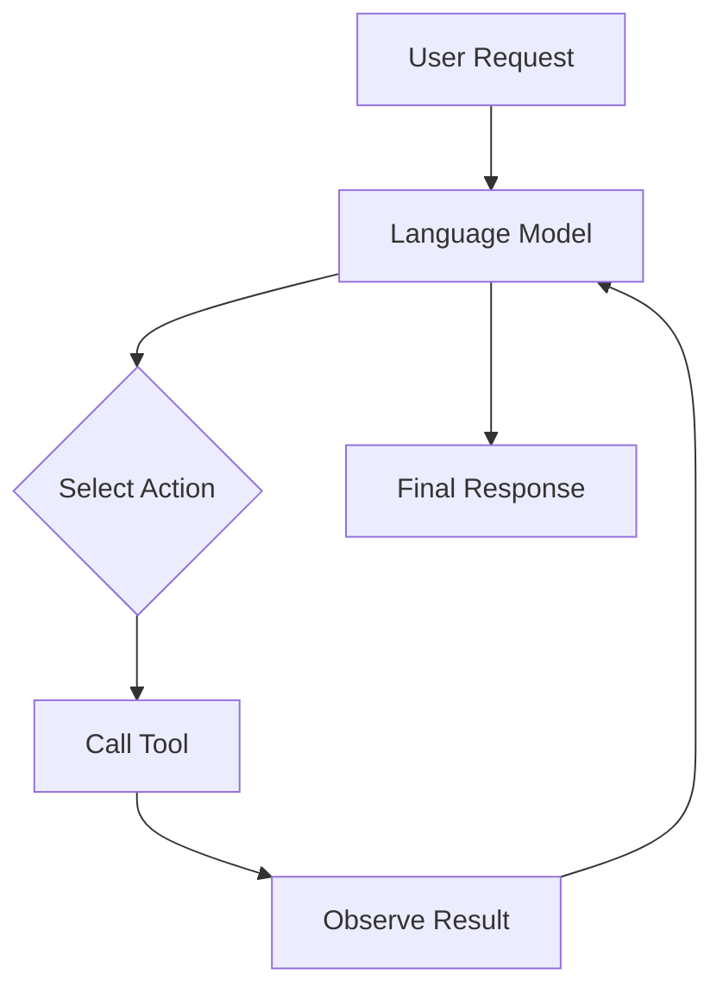

<div align="center">

# 🦜 LangChain AI Application Prototypes

### Exploring LLMs, RAG, AI Agents & Generative AI

A collection of Python experiments exploring how to build intelligent applications using Large Language Models, LangChain, embeddings, vector databases, and modern AI workflows.

[](https://www.python.org/)
[](https://www.langchain.com/)
[](https://openai.com/)
[](https://streamlit.io/)

[**Explore Repository**](https://github.com/ramtanay/LangChain-AI-Application-Prototypes) · [**Report an Issue**](https://github.com/ramtanay/LangChain-AI-Application-Prototypes/issues) · [**GitHub Profile**](https://github.com/ramtanay)

</div>

---

## 📌 Table of Contents

- [About the Project](#-about-the-project)
- [Project Goals](#-project-goals)
- [Key Features](#-key-features)
- [Concepts Explored](#-concepts-explored)
- [Repository Structure](#-repository-structure)
- [Technology Stack](#️-technology-stack)
- [Getting Started](#️-getting-started)
- [Environment Configuration](#-environment-configuration)
- [Running the Examples](#️-running-the-examples)
- [Learning Roadmap](#️-learning-roadmap)
- [Future Improvements](#-future-improvements)
- [Contributing](#-contributing)
- [Author](#-author)

---

## 🚀 About the Project

**LangChain AI Application Prototypes** is a collection of Python experiments focused on building applications powered by Large Language Models (LLMs).

The project explores the LangChain ecosystem, from basic model interactions and prompt engineering to more advanced application patterns such as Retrieval-Augmented Generation (RAG), conversational AI, embeddings, and tool-using agents.

It also includes experiments involving audio and image processing.

The repository is intended as a practical learning space for understanding how individual AI components work together to create useful applications.

### 🎯 Project Goals

- 🧠 Understand how LLM-powered applications work.
- 🔗 Build reusable workflows using LangChain Expression Language (LCEL).
- 📝 Explore prompt engineering and structured model outputs.
- 📚 Implement document-based question answering with RAG.
- 💬 Work with conversation history and contextual questions.
- 🔍 Experiment with embeddings and vector databases.
- 🤖 Explore AI agents and tool integration.
- 🎙️ Experiment with audio-processing applications.
- 🖼️ Explore image-processing workflows.
- 🛠️ Strengthen practical Python and AI development skills.

---

## ✨ Key Features

| Feature | Description |
|---|---|
| 🧠 **LLM Integrations** | Experiment with language models and model invocation. |
| 🔗 **Chains & LCEL** | Connect prompts, models, parsers, and other runnable components. |
| 📚 **Retrieval-Augmented Generation** | Explore document loading, text splitting, embeddings, retrieval, and context-grounded answers. |
| 💬 **Conversational AI** | Experiment with chat history and context-aware question answering. |
| 🤖 **AI Agents** | Explore tool integration and agent workflows. |
| 🎙️ **Audio & Image Processing** | Investigate audio- and image-processing experiments. |

---

## 🧠 Concepts Explored

### 1. 🔗 LangChain Expression Language (LCEL)

LCEL allows individual components to be composed into reusable workflows.

**Concepts:**
- Prompt templates
- Model invocation
- Output parsers
- Runnable composition
- Sequential processing
- Reusable AI pipelines

**Typical workflow:**



### 2. 📚 Retrieval-Augmented Generation (RAG)

Retrieval-Augmented Generation combines information retrieval with language generation. An application retrieves relevant information from a document collection and supplies it to a language model to help answer a question.

**Typical workflow:**



**Concepts explored:**
- Document loading
- Recursive text splitting
- Embedding generation
- Vector stores
- Similarity search
- Retriever-based question answering
- Context-grounded responses

### 3. 💬 History-Aware RAG

Conversational applications often need to understand follow-up questions using previous messages.

For example:

> **User:** What is Retrieval-Augmented Generation?
>
> **Assistant:** RAG combines information retrieval with language generation.
>
> **User:** What are its advantages?

A history-aware retriever can use the conversation history to interpret the follow-up question before retrieving relevant information.

**Concepts explored:**
- Conversation history
- Message placeholders
- Contextual question reformulation
- History-aware retrieval
- Conversational question answering
- Streamlit chat interfaces

### 4. 🤖 AI Agents

AI agents can use language models to select tools and perform tasks through structured workflows.

**Typical agent workflow:**



**Concepts explored:**
- Tool integration
- External search
- Knowledge retrieval
- Agent execution
- Tool outputs and observations
- LLM-driven decision workflows

*These diagrams illustrate general architectural patterns. The actual implementation depends on the specific example.*

### 5. 🎙️ Audio & Image Processing

The repository also contains experiments involving audio and image processing.

These experiments explore how input data beyond plain text can be processed as part of AI-powered applications.

**Areas of exploration:**
- Audio-processing experiments
- Speech-related applications
- Image-processing workflows
- Input-processing components for AI applications

---

## 🏗️ Repository Structure

The repository is organized into modules covering different areas of LLM application development.

```text
LangChain-AI-Application-Prototypes/
│
├── basics/             # Foundational LLM integrations
├── chains/             # LCEL and chain composition
├── prompttemplates/    # Prompt templates and prompt engineering
├── chathistory/        # Conversation history experiments
├── embeddings/         # Embeddings and similarity search
│
├── rag/                # Retrieval-Augmented Generation
│   ├── rag_demo.py
│   ├── pdf_rag_demo.py
│   └── historyaware_rag_demo.py
│
├── agents/             # AI agents and tool integration
├── audio_whisper/      # Audio-processing experiments
├── imageprocessing/    # Image-processing experiments
├── assignments/        # Exercises and additional experiments
│
├── requirements.txt    # Python dependencies
└── README.md           # Project documentation
```

> **Note:** This is an illustrative directory structure based on the modules documented here. Check the actual repository for the current filenames and directory contents before running an example.

---

## 🛠️ Technology Stack

| Technology | Purpose |
|---|---|
| **Python** | Core programming language |
| **LangChain** | Building LLM-powered applications |
| **LangChain Expression Language (LCEL)** | Composing reusable AI workflows |
| **OpenAI API** | Language models and embeddings for supported examples |
| **Ollama** | Local language-model experimentation |
| **Chroma** | Vector storage and retrieval in supported examples |
| **Streamlit** | Interactive application interfaces |
| **Document-processing libraries** | Loading and preparing documents |
| **Audio and image libraries** | Audio- and image-processing experiments |

*The technologies and dependencies required vary by example.*

---

## ⚙️ Getting Started

Follow these steps to set up the repository locally.

### Prerequisites

Install the tools required for the examples you want to run:

- [Python](https://www.python.org/downloads/)
- [Git](https://git-scm.com/downloads/)
- An OpenAI API key for examples that use the OpenAI API
- [Ollama](https://ollama.com/) for examples that use local Ollama models

You do not need every service for every example.

### 1. Clone the Repository

Open a terminal and run:

```bash
git clone https://github.com/ramtanay/LangChain-AI-Application-Prototypes.git
cd LangChain-AI-Application-Prototypes
```

### 2. Create a Virtual Environment

A virtual environment helps isolate this project's Python dependencies from other projects.

**Windows — PowerShell:**

```powershell
python -m venv .venv
.\.venv\Scripts\Activate.ps1
```

**Windows — Command Prompt:**

```bat
python -m venv .venv
.venv\Scripts\activate.bat
```

**Linux / macOS:**

```bash
python3 -m venv .venv
source .venv/bin/activate
```

### 3. Upgrade pip

```bash
python -m pip install --upgrade pip
```

### 4. Install Dependencies

```bash
python -m pip install -r requirements.txt
```

**Important:** The project-wide requirements file may not include every package needed by every experiment. If an example reports a missing dependency, check its imports and install the appropriate package inside your virtual environment.

Some examples may also require local data files or separately configured services.

---

## 🔑 Environment Configuration

Some examples require API keys or external services.

### Configure an OpenAI API Key

**Windows — PowerShell:**

```powershell
$env:OPENAI_API_KEY = "your_api_key_here"
```

**Windows — Command Prompt:**

```bat
set OPENAI_API_KEY=your_api_key_here
```

**Linux / macOS:**

```bash
export OPENAI_API_KEY="your_api_key_here"
```

Replace `your_api_key_here` with your own API key.

These commands set the environment variable for the current terminal session.

### 🔐 Security Best Practices

- Never commit API keys, passwords, or access tokens.
- Keep `.env` files out of Git by adding them to `.gitignore`.
- Avoid hardcoding secrets in Python files.
- Rotate any key that has been accidentally exposed.
- Configure only the credentials required by the example you are running.

If an example supports `.env` files, follow that example's instructions for loading them.

---

## ▶️ Running the Examples

The commands below are starting points for the documented examples. Run them from the repository root and confirm that the referenced files exist.

### 📚 Basic RAG

```bash
python rag/rag_demo.py
```

Explore document retrieval and question answering.

### 📄 PDF-Based RAG

```bash
python rag/pdf_rag_demo.py
```

Explore a RAG workflow that loads a PDF document.

Ensure that the PDF expected by the script exists at the path used by the implementation.

### 💬 History-Aware RAG

```bash
streamlit run rag/historyaware_rag_demo.py
```

Explore conversational question answering with chat history.

### 🤖 AI Agent

If the repository contains `agents/agent_demo.py`, you can run it with:

```bash
streamlit run agents/agent_demo.py
```

If that file does not exist, inspect the `agents/` directory and substitute the actual entry-point filename.

> **Troubleshooting tip:** If a command fails, check the file path, active Python environment, installed dependencies, environment variables, and required input files first.

---

## 🗺️ Learning Roadmap

A suggested order for exploring the concepts in this repository:

| Stage | Topic | Learning Focus |
|---|---|---|
| 1 | 🧠 LLM Basics | Model invocation and basic interactions |
| 2 | 📝 Prompt Engineering | Designing prompts and managing model inputs |
| 3 | 🔗 LCEL & Chains | Connecting components into reusable workflows |
| 4 | 🔍 Embeddings | Representing text and comparing semantic similarity |
| 5 | 📚 RAG | Retrieving document context for question answering |
| 6 | 💬 Conversational RAG | Using chat history to interpret follow-up questions |
| 7 | 🤖 AI Agents | Integrating tools into LLM-powered workflows |
| 8 | 🎙️ Audio & Images | Exploring input processing beyond plain text |

**Recommended approach:** Start with the basics, understand each component, and gradually combine components into more advanced applications.

---

## 🔮 Future Improvements

Potential improvements as the project evolves:

- [ ] Improve dependency management and reproducibility.
- [ ] Add setup instructions for individual examples.
- [ ] Add automated tests for reusable components.
- [ ] Improve error handling and configuration validation.
- [ ] Add persistent vector storage where appropriate.
- [ ] Evaluate retrieval quality with representative questions.
- [ ] Improve source attribution in RAG responses.
- [ ] Improve conversational session management.
- [ ] Add automated testing with GitHub Actions.
- [ ] Include screenshots and demonstrations of working applications.
- [ ] Document deployment options for selected applications.

---

## 🤝 Contributing

Suggestions, bug reports, documentation improvements, and new experiments are welcome!

To contribute:

1. Fork the repository.
2. Create a feature branch.
3. Make your changes.
4. Test the affected example.
5. Update the documentation if needed.
6. Submit a pull request explaining your changes.

For significant changes, consider opening an issue first to discuss the proposed improvement.

When reporting a bug, include the relevant error message and the steps needed to reproduce it. **Never include API keys or other secrets in an issue.**

---

## 👨‍💻 Author

<div align="center">

### Ramtanay Chakraborty

**Computer Science Engineer | Python Developer | Generative AI Enthusiast**

Exploring the intersection of Python, backend development, and Generative AI.

[](https://github.com/ramtanay)

⭐ **If you find this repository useful, consider giving it a star!**

</div>

---

<div align="center">

**Built with Python, curiosity, and a passion for Generative AI. 🦜**

</div>
